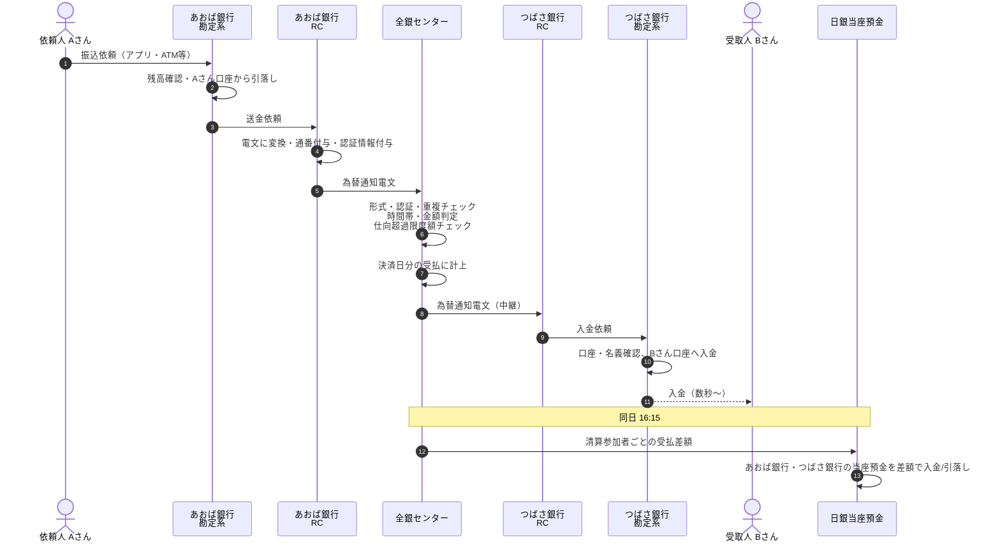

# 第1章　振込1件が着金するまで（全体の流れ）

[目次](README.md)　｜　[次章 →](02_relay_computer_and_network.md)

---

Aさん（あおば銀行）が、Bさん（つばさ銀行）に 5万円を振り込む、という平日昼の振込を例に、端から端まで追いかけます。

## 1.1 全体シーケンス



## 1.2 各ステップで起きていること

| # | 場所 | 処理 | ポイント |
|---|---|---|---|
| 1–2 | 仕向銀行 勘定系 | 依頼受付、依頼人口座から **先に引き落とす** | 引き落とした資金は「仕向為替（未決済）」として銀行内で管理 |
| 3–4 | 仕向銀行 RC | 全銀システム所定の電文に変換 | 勘定系ごとの違いを RC が吸収（→[第2章](02_relay_computer_and_network.md)） |
| 5 | 回線 | 専用ネットワークで全銀センターへ | |
| 6 | 全銀センター | 受信検証、ルーティング判定、リスクチェック | 1億円以上なら日銀ネットへ RTGS 指図（→[第5章](05_large_value_rtgs.md)） |
| 7 | 全銀センター | 当日決済分の受払に計上 | ネッティングの元データ（→[第4章](04_multilateral_netting_ccp.md)） |
| 8–10 | 被仕向銀行 | 口座の存在・名義を確認して入金 | 入金できなければ返却（→[第8章](08_returns_and_recalls.md)） |
| 11 | 受取人 | 入金を確認 | **銀行間の資金決済の前** に入金されている |
| 12–13 | 日銀 | 16:15 に差額決済 | 何千万件の取引が数本の資金移動に圧縮される |

## 1.3 お金の流れと情報の流れは別

この流れで重要なのは、**情報（為替通知）は即時に流れ、お金（銀行間の資金）は後でまとめて流れる** ことです。

| 時点 | Aさん口座 | Bさん口座 | あおば銀行の日銀当預 | つばさ銀行の日銀当預 |
|---|---|---|---|---|
| 振込前 | 100万 | 10万 | X | Y |
| 10:00 振込直後 | 95万（−5万） | **15万（+5万）** | X（**変化なし**） | Y（**変化なし**） |
| 16:15 決済後 | 95万 | 15万 | X − 差額 | Y + 差額 |

10:00〜16:15 の間、つばさ銀行は「あおば銀行から5万円を受け取る権利」を持ったまま、自分の資金で Bさんに入金していることになります。
この「立替え」の安全性を担保するのが、仕向超過限度額・担保・流動性供給の仕組みです（→[第3章](03_immediate_credit_deferred_settlement.md)、[第7章](07_settlement_guarantee_and_default.md)）。

## 1.4 模擬システムで確かめる

```bash
cd simulator
python -m zengin_sim run normal       # 約900件の振込 → 16:15 決済
python -m zengin_sim run normal -v    # 上のシーケンスに対応するログを逐次表示
```

ログの例（`-v`）:
```
[09:00:00] BANK     9001 振込受付 通番1 小口 50,000円 → 9002-101 ﾔﾏﾀﾞ ﾀﾛｳ
[09:00:00] CENTER   受付 9001-00000001 振込 9001→9002 50,000円
[09:00:00] NETTING  9001-00000001 を 2026-10-16 決済分に計上 9001→9002 50,000円
[09:00:00] BANK     9002 入金 ﾔﾏﾀﾞ ﾀﾛｳ +50,000円（9001通番1）
...
[16:15:00] SETTLE   2026-10-16 分の小口内為決済を開始（参加者 4）
[16:15:00] BOJ      振替 9001→ZNET 8,506,558円 (小口内為決済 支払(2026-10-16))
```
