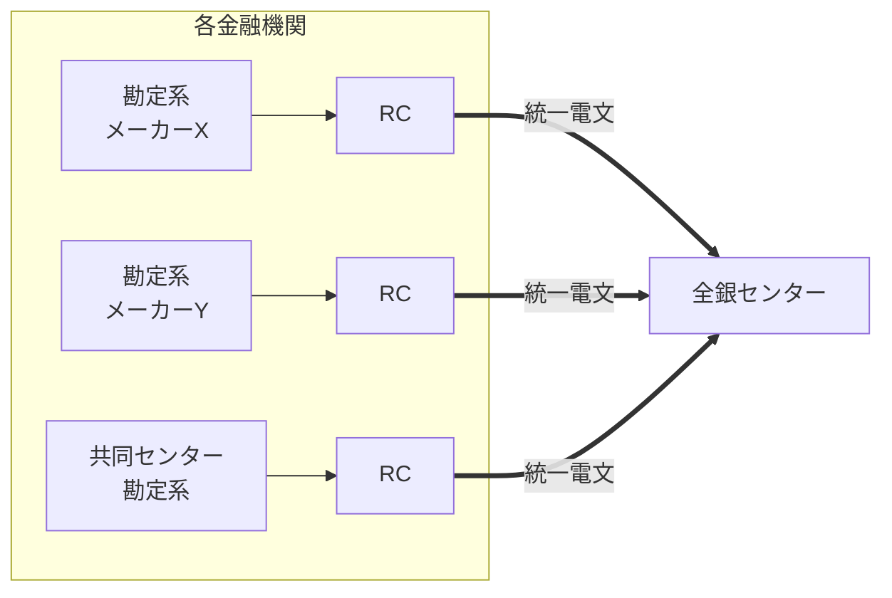
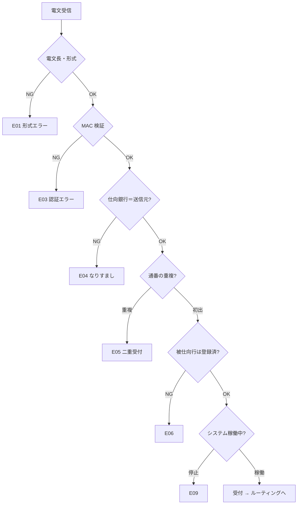

# 第2章　中継コンピュータ（RC）とネットワーク

[← 前章](01_end_to_end_flow.md)　｜　[目次](README.md)　｜　[次章 →](03_immediate_credit_deferred_settlement.md)

---

## 2.1 なぜ RC が必要なのか

全銀システムには 1,000 を超える金融機関がつながっていますが、各金融機関の勘定系システムはメーカーも設計もばらばらです。
もし全銀センターが各行の勘定系と直接やり取りすると、センター側が無数の方言に対応しなければなりません。

そこで各金融機関（または共同センター）側に **RC（Relay Computer：中継コンピュータ）** を置き、

- **勘定系 ⇔ RC**: 各行固有のインターフェース
- **RC ⇔ 全銀センター**: 全銀システムで統一された電文・通信手順

という形で、違いを RC で吸収します。



## 2.2 RC の主な役割

| 役割 | 内容 |
|---|---|
| 電文変換 | 勘定系の送金依頼を全銀システム所定の電文に変換する（逆方向も） |
| 通信制御 | センターとの回線制御、送達確認、再送 |
| 業務継続 | 勘定系や通信にトラブルがあっても取引を継続できるようにする機能（滞留・再送など） |
| 管理 | 通番管理、送受信ログ |

RC は全銀ネットの仕様に基づき開発され、各金融機関の拠点（または共同センター）に設置されます。
更改時期は各金融機関の RC の保守期限に合わせて順次決まります（→[仕様編 第9章](../spec/09_system_architecture.md)）。

## 2.3 電文の考え方 — 固定長・通番・認証

実際の電文仕様は非公開ですが、決済システムの電文には一般に次の考え方が使われます。模擬システムではこれを再現しています。

### 固定長

項目の位置と桁数があらかじめ決まっており、「何バイト目から何バイトが金額」と機械的に切り出せます。
可変長に比べて処理が速く、検証が容易です（全銀協規定フォーマットも同じ思想）。

### 通番（シーケンス番号）

仕向銀行が電文ごとに通番を振ります。センターは「仕向銀行コード＋通番」で **同じ電文を二重に処理しない** ようにします。
通信が途切れて再送したとき、同じ振込が2回入金される事故を防ぐための基本的な仕組みです。

### メッセージ認証（MAC）

電文本体から、送信者とセンターだけが知る鍵で計算した認証コードを付けます。1ビットでも改ざんされれば検証に失敗し、
別の銀行の鍵で作った電文（なりすまし）も検出できます。

```
模擬電文（194バイト）
┌──────────────────────── 本体 178バイト ───────────────────────┬─ MAC 16 ─┐
│ 種別|通番|送信日時|取扱日|仕向行店|被仕向行店|口座|受取人|依頼人|金額|EDI|… │ 5966B4…  │
└──────────────────────────────────────────────────────────────────┴──────────┘
```

模擬センターは、受信時に **仕向銀行の鍵** で MAC を検証し、中継時には **被仕向銀行の鍵** で再署名します。
こうすると各銀行はセンターとの間の鍵だけを持てばよく、銀行どうしで鍵を共有する必要がありません。

## 2.4 センターでの受信検証の順序（模擬）



## 2.5 RC が止まると何が起きるか

RC はその金融機関にとって全銀システムへの **唯一の出入口** です。RC が停止すると、

| 方向 | 影響 |
|---|---|
| 仕向（その銀行から他行へ） | 電文をセンターに送れない。顧客の振込は銀行内に滞留する |
| 被仕向（他行からその銀行へ） | センターは受け付けても、その銀行に届けられない。受取人に入金されない |

2023年10月の障害はまさにこの状態でした（→[第9章](09_incidents_and_bcp.md)）。

## 2.6 模擬システムで確かめる

```bash
python -m zengin_sim run telegram   # 模擬電文のバイナリダンプと MAC
python -m zengin_sim run rc         # RC 停止時の滞留と復旧後の自動送信
python -m unittest tests.test_system.FlowTest.test_security_checks   # 改ざん・なりすまし・二重受付
```

実装: `zengin_sim/telegram.py`（電文・MAC）、`zengin_sim/bank.py`（RC の滞留 `outbox`）、`zengin_sim/center.py`（`submit()` の検証）

### 参考資料
- ITmedia「『全銀システム障害』とは何だったのか」（RC の2つの役割） https://www.itmedia.co.jp/news/article/2312/28/1231228104/2
