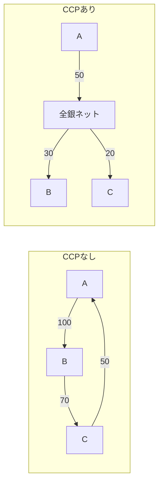
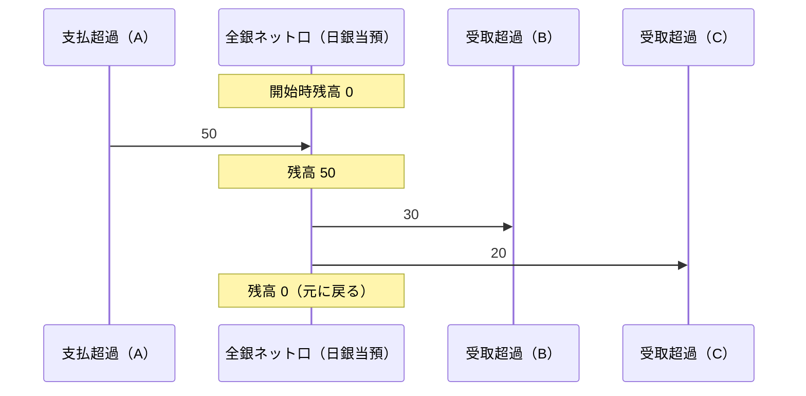

# 第4章　多角的ネッティングと CCP

[← 前章](03_immediate_credit_deferred_settlement.md)　｜　[目次](README.md)　｜　[次章 →](05_large_value_rtgs.md)

---

## 4.1 ネッティングとは

**ネッティング** は、複数の支払義務を相殺して差額だけを決済することです。

### 2者間（バイラテラル）ネッティング

A→B 100、B→A 70 なら、A→B 30 だけ払えばよい。

### 多角的（マルチラテラル）ネッティング

全参加者の支払・受取をすべて合算し、**参加者ごとに1つの差額** にまとめます。

例: 3行の取引

| 支払 \ 受取 | A | B | C |
|---|---|---|---|
| **A** | — | 100 | 0 |
| **B** | 0 | — | 70 |
| **C** | 50 | 0 | — |

| 参加者 | 支払（グロス） | 受取（グロス） | **受払差額（ネット）** |
|---|---|---|---|
| A | 100 | 50 | **−50** |
| B | 70 | 100 | **+30** |
| C | 50 | 70 | **+20** |
| 合計 | 220 | 220 | **0** |

- グロスでは 220 の資金移動が必要
- ネットでは A が 50 払い、B が 30、C が 20 受け取るだけ（資金移動 50）→ **約77%圧縮**
- 受払差額の合計は必ず **0** になる（誰かの支払は誰かの受取）。模擬システムはこれを毎回検証しています

## 4.2 CCP（セントラル・カウンターパーティ）

全銀ネットは、すべての取引について **支払側と受取側の間に入って当事者になる（債務を引き受ける）** CCP です。



CCP であることの効果:

| 効果 | 説明 |
|---|---|
| 相手方の一本化 | 各行の決済の相手方は全銀ネットだけ。どの銀行と取引したかに関係なく、差額を全銀ネットと受払いする |
| 信用リスクの集中管理 | 個々の銀行が相手行の信用力を審査する必要がない。リスクは全銀ネットが限度額・担保で一元管理 |
| 決済の確実性 | ある銀行が払えなくても、全銀ネットが（流動性供給を受けて）受取側に払う |

日本では 2001年1月に、決済の相手方が日本銀行から東京銀行協会に変更され、その後 2010年に全銀ネットへ承継されました。

## 4.3 16:15 の決済手順



1. 支払超過の参加者から全銀ネット口へ差額を振替
2. 全銀ネット口から受取超過の参加者へ差額を振替
3. 全銀ネット口の残高が元に戻ることを確認

支払側の誰かが払えない場合の処理は[第7章](07_settlement_guarantee_and_default.md)で説明します。

## 4.4 代行決済とネッティング

代行決済委託金融機関（多くの信金・信組等）の取引は、委託先の清算参加者のポジションに **合算** されます。
例えば「信金X → 銀行A」の振込は、ネッティング上は「系統中央機関 → 銀行A」として計上されます。
同じ委託先に属する金融機関どうしの取引は、清算参加者間の受払が生じません（委託先の内部で処理）。

## 4.5 ネッティングの効果の実例（模擬）

```
件数 683 / グロス総額 534,229,014円 / ネット決済額 40,078,490円 / 圧縮率 92.5%
```

参加者が多く、取引が双方向に大量に発生するほど圧縮率は高くなります。
逆に、取引が少ない日や一方向に偏る日（例：給与日に特定の銀行から大量に出る）は圧縮率が下がり、
支払超過の銀行は多くの資金を用意する必要があります。

## 4.6 ネッティングの法的な裏付け

ネッティングが有効であるためには、ある参加者が破綻したときに破産管財人が「受取分だけ請求し、支払分は払わない」（チェリー・ピッキング）
ことができないよう、法的に相殺が確定している必要があります。資金清算機関としての業務方法書と資金決済法の枠組みがこれを支えています。

## 4.7 模擬システムで確かめる

```bash
python -m zengin_sim run normal
python -m unittest tests.test_system.NettingTest
```

実装: `zengin_sim/settlement.py` の `NettingEngine`（`record`, `net_positions`, `report`）と `SettlementService.settle`

### 参考資料
- 全国銀行協会「新内国為替制度への移行について」（2001年1月、CCP の変更） https://www.zenginkyo.or.jp/news/2001/n2615/
- 日本銀行「教えて！にちぎん：民間資金決済システムでの金融機関間の受払」 https://www.boj.or.jp/about/education/oshiete/kess/i27.htm
