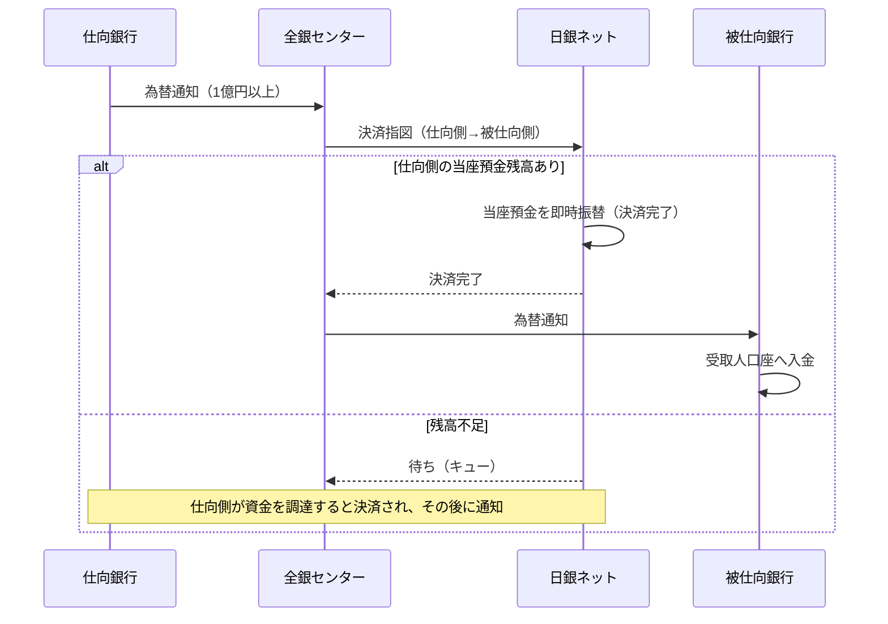

# 第5章　大口取引の RTGS 処理

[← 前章](04_multilateral_netting_ccp.md)　｜　[目次](README.md)　｜　[次章 →](06_moretime.md)

---

## 5.1 RTGS とは

**RTGS（Real-Time Gross Settlement：即時グロス決済）** は、支払指図を1件ずつ、受け付けた時点で最終的に決済する方式です。
日本銀行は2001年1月に当座預金決済を RTGS 化し、全銀システムの1億円以上の取引も日銀ネットで RTGS 決済されるようになりました（2011年11月〜）。

| | 時点ネット決済（小口） | RTGS（大口） |
|---|---|---|
| 単位 | 差額 | 1件ごと |
| タイミング | 16:15 | 即時 |
| 未決済残高 | 日中に積み上がる | 残らない |
| 必要流動性 | 少ない | 多い |
| システミック・リスク | 管理が必要 | 小さい |

## 5.2 なぜ1億円以上を分けるのか

- 金額が大きい取引ほど、決済不能時の影響が大きい
- 件数ではごく一部だが、金額では大きな割合を占める
- 大口だけを RTGS に回せば、**未決済残高（＝リスク）の大部分を消しつつ**、件数の大半を占める小口では効率的なネッティングを維持できる

2004年の全銀協提言では、日銀ネット・外為円決済システム・全銀システムに分散していた大口決済を日銀ネット中心に再編する方向が示され、
全銀システムは小口中心という役割分担が明確になりました。

## 5.3 処理の流れ



ポイントは **決済が完了してから為替通知が届く** ことです。被仕向銀行は、資金を受け取ってから受取人に入金するので立替えが生じません。

## 5.4 資金不足時の待ち行列

仕向側の清算参加者の当座預金残高が不足していると、決済指図は待ち行列に入り、資金が入るのを待ちます。
銀行はコール市場での調達や、日本銀行の日中当座貸越（適格担保の範囲内）などで資金を確保します。

模擬システムでは:
- 残高不足の大口は `RTGS決済待ち` になり、`center.rtgs_queue` に入る
- 資金が入る（`boj.inject` やダッシュボードの「入金」）と、次の定期処理で自動的に決済・通知される
- 16:15 までに決済できなければ **不受理** として仕向銀行に返され、依頼人へ返金される（模擬上の設計）

## 5.5 夜間・休日の大口

モアタイムで即時処理されるのは1億円未満の取引です。夜間・休日に受け付けた大口は、翌営業日のコアタイムに処理されます。
模擬システムでは「予約（大口取引はコアタイムのみ取扱い）」となり、翌営業日 8:30 に解放されます。

## 5.6 模擬システムで確かめる

```bash
python -m zengin_sim run large
```

```
9001 → 9003 に 3億円を振込 → 入金済（日銀ネットで即時決済後に為替通知）
9003 から 9002 へ 50億円（日銀当預 43億円）→ RTGS決済待ち
10:00 9003 が 20億円 を調達 → 入金済
18:00 に 2億円 → 予約(取扱日待ち) → 翌営業日 8:31 → 入金済
```

実装: `center.py` の `_execute_large()`、`_retry_rtgs()`

### 参考資料
- 日本銀行「教えて！にちぎん」（1件1億円以上は RTGS） https://www.boj.or.jp/about/education/oshiete/kess/i27.htm
- 全国銀行協会「大口決済システムの構築等資金決済システムの再編について（提言）」（2004年3月） https://www.zenginkyo.or.jp/news/2004/n2731/
