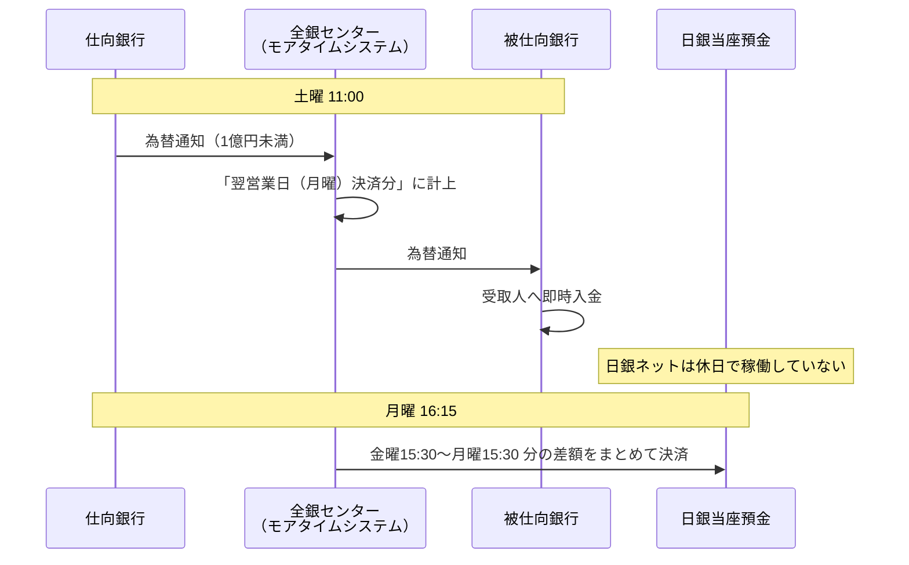

# 第6章　モアタイムの仕組み

[← 前章](05_large_value_rtgs.md)　｜　[目次](README.md)　｜　[次章 →](07_settlement_guarantee_and_default.md)

---

## 6.1 モアタイムとは

2018年10月に稼働した **モアタイムシステム** により、平日夜間・土日祝日も、他行宛ての振込が即時に受取人口座へ入金されるようになりました。
コアタイム（平日 8:30〜15:30）以外の時間帯を担当するのがモアタイムシステムです。

## 6.2 「即時入金」と「翌営業日決済」

モアタイムの核心は、**入金は即時、銀行間の資金決済は翌営業日** という分離です（第3章の考え方の延長）。



日銀当座預金の決済（日銀ネット）は休日には動かないため、休日の取引は翌営業日の決済にまとめられます。
その結果、**月曜の決済には金曜夜から月曜日中までの取引が含まれ**、休日明けは銀行間の未決済残高が大きくなりやすい特徴があります。

## 6.3 リスク管理への影響

| 論点 | 内容 |
|---|---|
| 未決済期間の長期化 | 金曜夜の取引は月曜 16:15 まで、連休なら更に長く未決済が続く |
| 仕向超過限度額 | モアタイムの取引も限度額管理の対象。休日中も受取・支払でポジションが変動する |
| 流動性 | 休日明けの決済では、支払超過額が大きくなりうる |

このため、モアタイムでは対象を1億円未満に限り、大口は翌営業日のコアタイムで RTGS 処理します。

## 6.4 参加は任意 — 非参加行との取引

モアタイムへの参加は各金融機関の判断です。また参加行でも、受付時間帯やチャネル・金額上限を独自に設定していることがあります。

| 仕向 | 被仕向 | 夜間・休日の振込 |
|---|---|---|
| 参加 | 参加 | 即時入金 |
| 参加 | **非参加** | 翌営業日の扱い（予約） |
| **非参加** | 参加 | 翌営業日の扱い |

模擬システムでは、非参加行（9102 こもれび信用組合）宛ての振込を夜間・休日に送ると「予約（被仕向行がモアタイム非参加）」となり、
翌営業日 8:30 のコアタイム開始と同時に解放・入金されます。

## 6.5 なぜ1つのシステムでなく2つなのか

公開資料からうかがえる理由（推察を含む）:

- コアタイムシステムは長年の実績があり、大口 RTGS・日銀ネット連携・大量処理を前提に設計されている
- 24時間化をコアタイムシステムの改修で実現すると、システム停止を伴う保守や切替の時間が取りにくくなる
- 別システムとして追加することで、既存システムへの影響を抑えつつ稼働時間を拡大できる

## 6.6 模擬システムで確かめる

```bash
python -m zengin_sim run moretime
```

```
10/16(金) 20:00 9001→9002 3万円 → 入金済
   資金決済日: 2026-10-19（土日を挟むため翌営業日 10/19）
10/17(土) 9001→9102(モアタイム非参加の信組) 5万円 → 予約(取扱日待ち)
10/19(月) 8:31 → 入金済
```

実装: `bizcal.py` の `settlement_date_for()`、`center.py` の `_can_process_now()`・`_release_reserved()`

### 参考資料
- 日本銀行「教えて！にちぎん」（2018年10月より24時間365日の即時送金環境） https://www.boj.or.jp/about/education/oshiete/kess/i27.htm
- Business Insider Japan（コアタイムとモアタイムの2システム構成） https://www.businessinsider.jp/article/276648/
