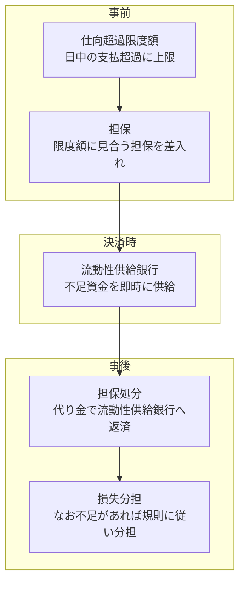
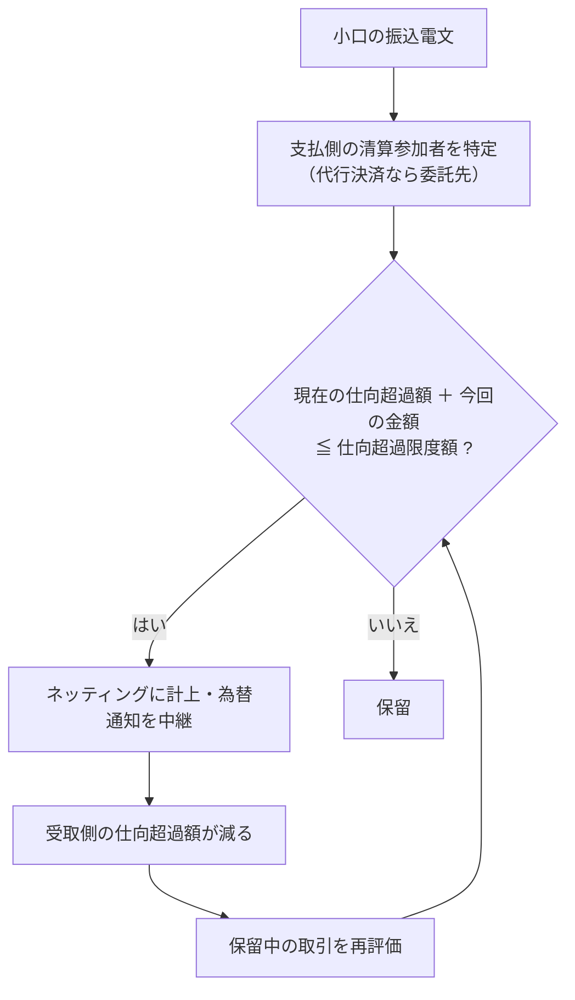
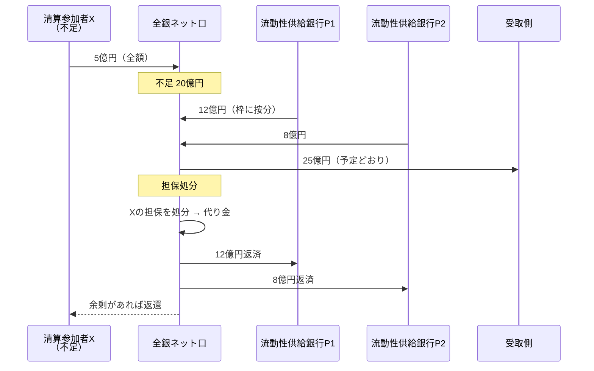

# 第7章　決済完了の確保と決済不能時の処理

[← 前章](06_moretime.md)　｜　[目次](README.md)　｜　[次章 →](08_returns_and_recalls.md)

---

## 7.1 守るべきもの

小口取引では受取人への入金が先、銀行間決済が後です。全銀ネットが守らなければならないのは、

> **ある参加者が 16:15 に払えなくなっても、他の参加者への支払を予定どおり完了させること**

です。払えない参加者が出るたびに決済をやり直す（その参加者の取引を取り消して再計算する＝アンワインド）と、
他の銀行の受払差額が変わり、連鎖的な混乱を招きます。全銀システムはアンワインドをせずに決済を完了させる設計です。

## 7.2 3段構えの仕組み



| 段階 | 仕組み | 何を防ぐか |
|---|---|---|
| ① 事前 | **仕向超過限度額** — 支払超過がこれを超える取引は処理しない | 1行の未決済債務が無制限に膨らむこと |
| ② 事前 | **担保** — 限度額に見合う担保を差し入れさせる | 決済不能時に回収原資がないこと |
| ③ 決済時 | **流動性供給銀行** — 不足額を即時に供給 | 担保の処分を待つ間に決済が止まること |
| ④ 事後 | **担保処分・損失分担** | 流動性供給銀行に最終的な損失を負わせないこと（残れば規則で分担） |

担保だけでは足りない理由は **時間** です。国債などの担保を現金化するには時間がかかりますが、決済は 16:15 に完了させなければなりません。
そこで、まず流動性供給銀行が現金を即時に出し、後から担保の処分代り金で返す、という役割分担になっています。

## 7.3 仕向超過限度額のリアルタイム管理



模擬システムの設計:
- 保留は **清算参加者ごとの FIFO**。先頭が通らなければ後続も待つ（小さい取引が追い越さない）
- 保留は受付時点の **決済日に紐づく**。その決済日の 16:15 までに限度額内に収まらなければ不受理とし、依頼人に返金
- 実際の全銀システムの保留・返却の運用ルールは全銀ネットの規則によります

## 7.4 決済不能時の資金の流れ

例: 清算参加者 X（受払差額 −25億円）の日銀当預が 5億円しかない。流動性供給銀行は P1（枠120億円）・P2（枠80億円）。



結果として:
- 受取側は予定どおり受け取る（**決済完了性**）
- 流動性供給銀行は一時的に資金を出すが、担保処分で回収
- 損失は不払い参加者の担保で吸収される

## 7.5 「最大の参加者が払えなくても」— 規模の考え方

国際基準（PFMI）は、ネット決済システムに対して「最大の支払超過を持つ参加者が決済不能になった場合」にも決済を完了できる流動性の確保を求めています。
仕向超過限度額は、流動性供給の枠・担保と整合するように設定する必要があります。

模擬システムでは `risk.py` の `set_cap()` が「担保評価額 ≧ 限度額 × カバー率」を満たさない限度額の設定を拒否します
（カバー率は `config.COLLATERAL_COVERAGE_RATIO`、既定 1.0）。

## 7.6 模擬システムで確かめる

```bash
python -m zengin_sim run limit     # 限度額による保留 → 解除 → 不受理
python -m zengin_sim run default   # 決済不能 → 流動性供給 → 担保処分
```

```
9003 の仕向超過額 2,499,999,975円（限度額 3,000,000,000円 以内なので受付）
15:00 9003 の日銀当預 → 5億円 に
2026-10-16 決済: 支払 1先 / 受取 1先 / 決済総額 2,499,999,975円 / 決済不能 1先（流動性供給により決済完了）
  不履行参加者 9003 不足額 1,999,999,975円
    流動性供給 9001: 1,199,999,985円
    流動性供給 9002: 799,999,990円
    担保処分代り金 3,500,000,000円 → 流動性供給銀行へ返済
```

実装: `settlement.py` の `SettlementService._handle_default()`、`risk.py` の `draw_liquidity()`・`liquidate()`

### 参考資料
- 全国銀行協会「全銀システム」（仕向超過額の限度額管理と担保の受入れ） https://www.zenginkyo.or.jp/abstract/efforts/system/zengin-system/
- 全国銀行協会「新内国為替制度への移行について」（2001年、決済リスク対策の強化） https://www.zenginkyo.or.jp/news/2001/n2615/
