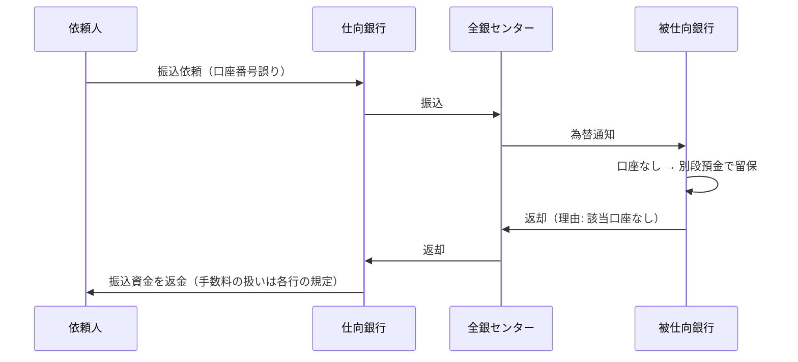
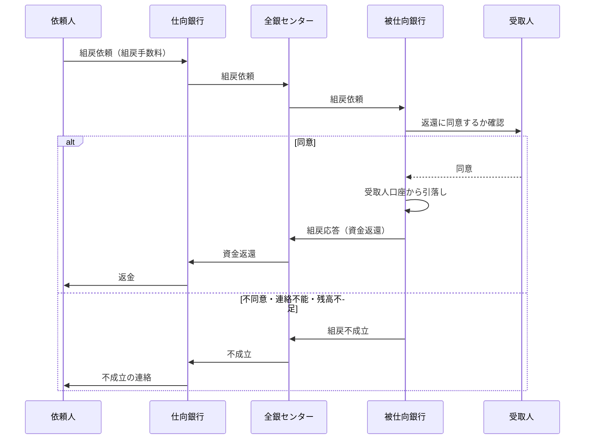

# 第8章　入金不能・返却・組戻

[← 前章](07_settlement_guarantee_and_default.md)　｜　[目次](README.md)　｜　[次章 →](09_incidents_and_bcp.md)

---

振込は「送ったら終わり」ではありません。届いた先で入金できない場合や、依頼人が取り消したい場合の仕組みがあります。

## 8.1 被仕向銀行での入金チェック

被仕向銀行は為替通知を受けると、主に次を確認してから入金します。

| チェック | 入金できない例 |
|---|---|
| 口座の存在 | 支店番号・口座番号に該当する口座がない |
| 口座の状態 | 解約済、支払停止（不正利用等による凍結） |
| 名義 | 受取人名が口座名義と一致しない |

受取人名の照合方法（どこまでの相違を許容するか、人手で確認するか）は金融機関ごとに異なります。

## 8.2 返却（入金不能）

入金できない場合、被仕向銀行はいったん資金を **別段預金** などで預かり、仕向銀行へ **返却** の為替を送ります。



- 返却も資金の移動を伴う為替なので、銀行間決済（ネッティング）に計上される（元の振込と逆向き）
- 依頼人の振込手数料が返されるかどうかは金融機関の規定による

## 8.3 組戻（依頼人による取消）

**組戻** は、依頼人が振込を取り消したいとき（誤振込・二重振込など）に、仕向銀行を通じて被仕向銀行へ資金の返還を依頼する手続きです。



### なぜ受取人の同意が必要か

- 着信した時点で、資金は受取人の **預金** になっている
- 被仕向銀行が受取人の預金を勝手に引き落とすことはできない
- そのため、組戻は受取人の同意が前提。同意が得られない場合、依頼人は受取人に対して直接返還を求める（不当利得返還請求など）ことになる

| | 返却 | 組戻 |
|---|---|---|
| 起点 | 被仕向銀行（入金できない） | 依頼人（取り消したい） |
| 受取人への入金 | されていない | されている |
| 受取人の同意 | 不要 | **必要** |
| 成否 | 原則として返る | 同意次第 |

## 8.4 犯罪利用への対応

振り込め詐欺等の被害では、口座の凍結（支払停止）や、振り込め詐欺救済法に基づく被害回復分配金の手続きが別途行われます。
将来の新決済システム構想では、送金前に受取人口座を確認する **事前口座確認** の導入が検討されています（→[第10章](10_history_and_future.md)）。

## 8.5 模擬システムで確かめる

```bash
python -m zengin_sim run recall
```

```
(1) 存在しない口座宛て → 入金不能返却（該当口座なし）、依頼人残高は元通り
(2) 名義相違 → 入金不能返却（受取人名相違）
(3) 誤振込 → 組戻依頼 → 受取人同意 → 組戻済
(4) 受取人が不同意 → 組戻不成立
```

模擬電文の種別: 1001 振込 / 2001 組戻依頼 / 2002 組戻応答 / 3001 入金不能返却。理由コードは
[simulator/README.md「6.2」](../simulator/README.md#62-模擬為替通知電文独自形式)を参照。

実装: `bank.py` の `_receive_transfer()`・`_receive_recall_req()`・`_reply()`
