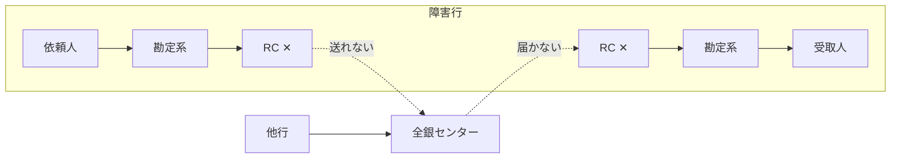

# 第9章　障害と事業継続 — 2023年10月障害の分析

[← 前章](08_returns_and_recalls.md)　｜　[目次](README.md)　｜　[次章 →](10_history_and_future.md)

---

## 9.1 概要

2023年10月10日〜11日、全銀システムで、1973年の稼働以来初となる顧客影響を伴う大規模障害が発生しました。

| 項目 | 内容 |
|---|---|
| 発生 | 2023年10月10日（火）8:30 コアタイム開始直後 |
| 影響金融機関 | 三菱UFJ銀行、りそな銀行、埼玉りそな銀行、関西みらい銀行、山口銀行、北九州銀行、三菱UFJ信託銀行、日本カストディ銀行、もみじ銀行、商工組合中央金庫 の10機関 |
| 影響 | 上記金融機関と他行との振込等の為替取引が不能・遅延。影響を受けた取引は約506万件、うち当日処理できなかったものは約87万件と報じられた |
| 復旧 | 10月12日の営業開始時から通常どおり処理 |
| その後 | 金融庁が資金決済法に基づく報告徴求命令。全銀ネットは原因分析・再発防止策を報告 |

## 9.2 何が起きたか

全銀システムは定期的に機器・ソフトウェアを更新しており、このとき各金融機関の **RC（中継コンピュータ）** を
2017年更改の「RC17」から新機種「RC23」へ入れ替える作業が、10月7日〜9日の3連休に行われました（第8次全銀システムへの最初の入替）。

```mermaid
timeline
  title 2023年10月 障害の経過（報道ベース）
  10月7日〜9日 : 3連休に14行の RC を新機種（RC23）へ切替
  10月10日 8:30 : コアタイム開始直後、10行の RC がダウン
               : 他行宛て振込・他行からの入金が処理できない状態に
  10月10日〜11日 : 復旧作業。代替手段での送信等も実施
               : 不具合が残る中で取引を継続
  10月11日夜 : 暫定対処（プログラムの一部を簡易版で作り直し）
  10月12日 : 営業開始から通常どおり処理
```

### 原因（全銀ネット・NTTデータの説明による）

- RC23 の本番環境を構築する際に使う **生成プログラムの不具合** により、
- 金融機関テーブル（接続先金融機関の情報）を拡張した際に必要な **作業領域が不足** し、
- RC 本体装置がシステムダウンし、テレ為替業務が全面的に不能となった

開発ベンダー（NTTデータ）による単体・結合・総合試験、全銀ネットの受入試験（金融機関との接続試験を含む）、
相互運転試験を経ていたにもかかわらず、本番環境固有の条件で顕在化した点が議論を呼びました。

## 9.3 構造的に何が問題だったか

| 観点 | 内容 |
|---|---|
| 単一の出入口 | RC はその金融機関にとって全銀システムへの唯一の接続点。止まると送受信の両方が止まる（→[第2章](02_relay_computer_and_network.md)） |
| 冗長化の限界 | 機器を二重化していても、同じソフトウェアの同じ不具合は両系で発生する |
| 共通原因 | 14行のうち10行で同時に発生（同じ RC ソフトウェア・同じ生成手順） |
| 試験と本番の差 | 本番データ量・テーブル構成でのみ発生する条件を試験で再現できていなかった |
| 代替手段 | 代替手段（ファイル等による送信）は大量の取引に即座には対応しにくかった |
| 移行計画 | 3連休中の切替。問題が出ても切り戻し（旧 RC17 へ戻す）判断が難しかった |

## 9.4 影響の構図



- **障害行から他行へ**: 顧客の依頼は受けても全銀センターへ送れない
- **他行から障害行へ**: 他行は送れて全銀センターも受け付けるが、障害行に届かない → 受取人に入金されない
- 給与・年金・企業間決済が集中する連休明けの平日だったため、影響が大きかった

## 9.5 再発防止策（公表内容の要旨）

- 生成プログラム・作業領域の見直しと、同種の不具合の総点検
- 試験の強化（本番相当データ・環境での試験）
- 段階的な移行（一斉切替を避ける）と切り戻し手順の整備
- 代替手段の実効性向上（障害時でも重要な取引を処理できるように）
- 全銀ネットのガバナンス・ベンダー管理の強化
- 定期的な金融庁への進捗報告

NTTデータグループも「システム総点検タスクフォース」を設置し、決済系・勘定系等のシステムを総点検すると表明しました。

## 9.6 模擬システムで確かめる

```bash
python -m zengin_sim run rc
```

```
8:00 RC を新機種へ切替えた 9001 の RC が、コアタイム開始時に停止したと仮定
9001 発の振込 5件 → 仕向行RC滞留（9001 の RC に滞留: 5件）
9001 宛の振込 5件 → 被仕向行へ未着（センター側で再送待ち: 5件）
13:00 暫定対処で RC 復旧 → 9001 発 → 入金済 / 9001 宛 → 入金済
```

> 模擬の簡略化: 実際の障害では RC 本体がダウンし、滞留処理も機能しませんでした。模擬では「RC は電文を保持できるが送受信できない」状態として
> 復旧後の自動送信まで再現しています。現実の復旧では代替手段での送信や再送の突合せに多大な人手を要しました。

ダッシュボードでも「RC停止」ボタンで同じ状況を作れます。停止中に他行から振込を送ると、取引一覧に「被仕向行へ未着」が並びます。

### 参考資料
- paymentnavi「全銀ネットがシステム障害での再発防止策を説明」（2023年12月） https://paymentnavi.com/paymentnews/139685.html
- gihyo.jp「バグは"数千パターンのテスト"すり抜けた ―NTTデータ『2023/10/10 全銀ネット障害』について説明」 https://gihyo.jp/article/2023/11/zengin-nttdata
- Business Insider Japan「全銀システム障害」関連記事 https://www.businessinsider.jp/post-276987
- IT Leaders「全銀システム障害が浮き彫りにしたもの」 https://it.impress.co.jp/articles/-/25568
- ITmedia「『全銀システム障害』とは何だったのか」 https://www.itmedia.co.jp/news/article/2312/28/1231228104/2
