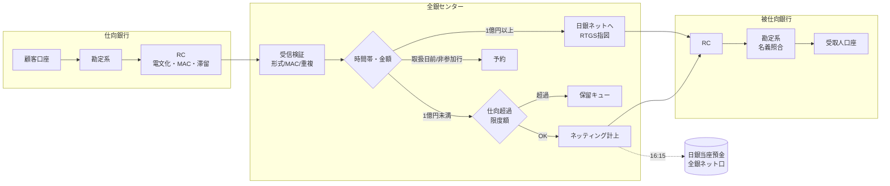
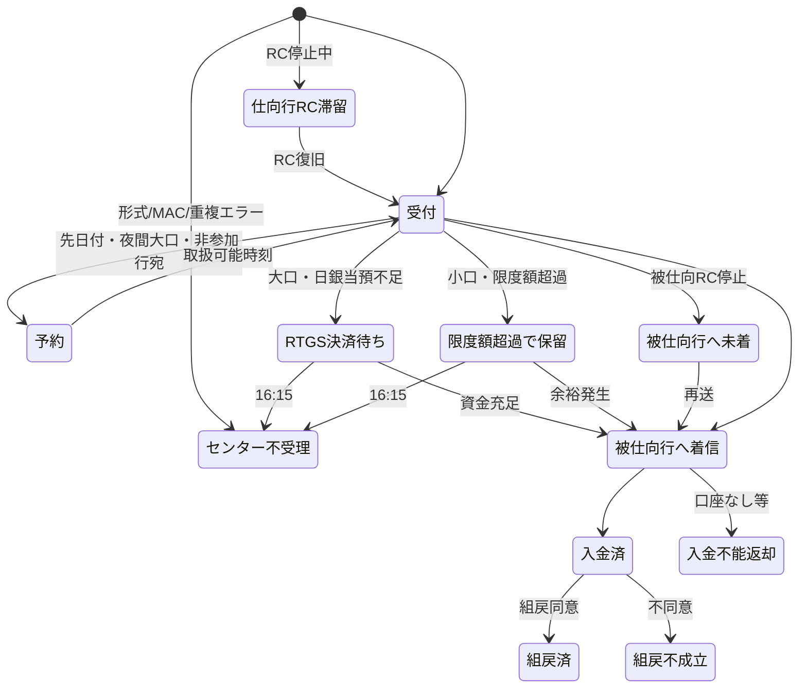

# 全銀システム 模擬シミュレータ

[← トップへ戻る](../README.md)

公開情報をもとに、全銀システムの主要な仕組みを **動かして確かめられる** ようにした学習用シミュレータです。
Python 3.10 以上・**標準ライブラリのみ**で動作します（追加インストール不要）。

> **注意**　金融機関名・コード・口座はすべて架空です。銀行間の電文フォーマット（全銀センター⇔RC）は
> 実際の仕様が非公開のため **独自の模擬形式** です。一方、企業⇔銀行の **全銀協規定フォーマット（総合振込・120バイト）** は
> 公開仕様のレコード構成に沿って実装しています。

---

## 1. クイックスタート

```bash
cd simulator

python -m zengin_sim list               # シナリオ一覧
python -m zengin_sim run normal         # 平常日の処理とネッティング
python -m zengin_sim run all            # 全シナリオを順に実行
python -m zengin_sim run default -v     # -v でイベントログを逐次表示
python -m zengin_sim serve              # Web ダッシュボード → http://127.0.0.1:8000/

python -m unittest discover -s tests -t .   # テスト（29件）
```

## 2. 何が再現されているか

| 仕組み | 模擬内容 | 関連する解説 |
|---|---|---|
| 為替通知の中継 | 仕向行 RC → 全銀センター → 被仕向行 RC。MAC 検証・二重受付防止・なりすまし検知 | [仕組み2章](../mechanism/02_relay_computer_and_network.md) |
| 即時入金と後決済の分離 | 受取人口座へは着信時点で入金、銀行間の資金は 16:15 にまとめて決済 | [仕組み3章](../mechanism/03_immediate_credit_deferred_settlement.md) |
| 多角的ネッティング / CCP | 決済日ごとに清算参加者別の受払差額を算出し、全銀ネット名義口を介して決済 | [仕組み4章](../mechanism/04_multilateral_netting_ccp.md) |
| 大口内為取引の RTGS | 1件1億円以上は日銀当預で即時グロス決済。残高不足は待ち行列、当日中に決済できなければ不受理 | [仕組み5章](../mechanism/05_large_value_rtgs.md) |
| モアタイム | 平日夜間・土日祝も即時入金。決済は翌営業日。モアタイム非参加行宛ては予約扱い | [仕組み6章](../mechanism/06_moretime.md) |
| 仕向超過限度額 | 限度額を超える小口取引を保留 → 受取で余裕が生じれば自動解除 → 決済時刻まで残れば不受理 | [仕様7章](../spec/07_risk_management.md) |
| 決済不能時の処理 | 流動性供給銀行が不足資金を即時供給 → 担保処分代り金で返済 → 決済は完了 | [仕組み7章](../mechanism/07_settlement_guarantee_and_default.md) |
| 代行決済 | 信金・信組・資金移動業者は委託先の清算参加者のポジションに合算 | [仕様2章](../spec/02_participation.md) |
| 入金不能・組戻 | 口座なし・名義相違は返却電文、誤振込は組戻依頼 → 受取人同意で返還 | [仕組み8章](../mechanism/08_returns_and_recalls.md) |
| RC 障害 | 仕向側は RC 内に滞留、被仕向側はセンターで再送待ち。復旧後に自動送信 | [仕組み9章](../mechanism/09_incidents_and_bcp.md) |
| 全銀協フォーマット | 総合振込ファイルの生成・パース・検証（合計件数/金額、文字種、レコード順） | [仕様5章](../spec/05_data_formats.md) |
| 内国為替制度運営費 | 1件62円を仕向→被仕向で月次集計 | [仕様8章](../spec/08_fees.md) |

## 3. アーキテクチャ



### モジュール構成

```
zengin_sim/
├── config.py         定数（1億円閾値・コアタイム・16:15・62円 等）
├── bizcal.py         営業日カレンダー（2026–2027祝日）・模擬時計・決済日判定
├── kana.py           全銀文字（半角カナ）変換・法人略語・名義照合キー
├── fixed.py          固定長レコードの汎用エンコーダ/デコーダ（cp932）
├── zengin_format.py  全銀協規定フォーマット（総合振込120バイト）生成・パース・検証
├── telegram.py       模擬為替通知電文（178B + MAC16B）・HMAC・ダンプ
├── models.py         Bank / Account / TxRecord / 状態定義
├── bank.py           参加金融機関（勘定系 + RC）：仕向・被仕向・返却・組戻・滞留
├── center.py         全銀センター：検証・ルーティング・予約・保留・RTGS・中継・再送
├── settlement.py     多角的ネッティングと 16:15 決済・決済不能処理
├── boj.py            日銀ネット（当座預金・RTGS）
├── risk.py           仕向超過限度額・担保・流動性供給銀行
├── fees.py           内国為替制度運営費
├── events.py         監査ログ（JSON Lines 出力可）
├── world.py          架空の参加者・口座の初期構成とシミュレーション制御
├── scenarios.py      学習シナリオ 9 本
├── report.py         コンソール表示整形
├── cli.py            コマンドライン
├── web.py            Web API サーバ（http.server）
└── static/dashboard.html  ダッシュボード UI
```

### 架空の参加金融機関

| コード | 名称 | 区分 | モアタイム | 日銀当預 | 仕向超過限度額 | 流動性供給枠 |
|---|---|---|---|---|---|---|
| 9001 | あおば銀行 | 清算参加者 | ○ | 300億円 | 250億円 | 120億円 |
| 9002 | つばさ銀行 | 清算参加者 | ○ | 200億円 | 170億円 | 80億円 |
| 9003 | はるかぜ銀行 | 清算参加者 | ○ | 40億円 | 30億円 | — |
| 9100 | みどり信用金庫連合会 | 清算参加者（系統中央機関） | ○ | 80億円 | 55億円 | — |
| 9101 | ひだまり信用金庫 | 代行決済委託（→9100） | ○ | — | — | — |
| 9102 | こもれび信用組合 | 代行決済委託（→9100） | **×** | — | — | — |
| 9500 | ペイライト（資金移動業者） | 代行決済委託（→9002） | ○ | — | — | — |

## 4. シナリオ

| 名前 | 内容 | 見どころ |
|---|---|---|
| `normal` | 約900件のランダム振込 → 16:15 決済 | グロス数億円がネットで1割未満に圧縮される。全銀ネット口は決済後0に戻る |
| `large` | 3億円の RTGS、50億円の残高不足→待ち行列→資金調達で決済、夜間の大口は予約 | 大口は「決済してから通知」、小口は「通知してから決済」 |
| `moretime` | 金曜夜・土曜の振込、モアタイム非参加信組宛て | 即時入金されるが決済日は翌営業日 |
| `limit` | 限度額5,000万円で2,000万円×4件 | 保留 → 受取で解除 → 残りは 16:15 で不受理・返金 |
| `default` | 9003 が決済資金不足 | 流動性供給 → 担保処分 → 受取側は満額受領 |
| `rc` | 9001 の RC が朝から停止 | 2023年10月の障害の構図（送れない・受け取れない）を体験 |
| `recall` | 口座なし・名義相違・誤振込の組戻・受取人不同意 | 返却電文と組戻電文の流れ |
| `file` | 総合振込ファイル生成→パース→一括送信 | 120バイト固定長・EDI情報 |
| `telegram` | 模擬電文のバイナリダンプ | 固定長電文と MAC |

## 5. Web ダッシュボード

`python -m zengin_sim serve` で起動し、ブラウザで `http://127.0.0.1:8000/` を開きます。

- 時計操作（+10分 / +1時間 / →15:30 / →16:15 決済 / →翌朝8:30）
- ランダム振込・大口混在の投入、任意の口座間振込（EDI情報付き可）
- RC 停止/復旧、コアタイム系・モアタイム系システムの停止/再開、日銀当預への入金
- 清算参加者ごとの日銀当預・ネットポジション・限度額使用率バー
- 取引一覧（行にカーソルを当てると状態遷移履歴）、ネッティング表、イベントログ

### API（JSON）

| メソッド | パス | ボディ例 |
|---|---|---|
| GET | `/api/state` | — |
| POST | `/api/transfer` | `{"from_bank":"9001","from_branch":"100","from_type":1,"from_no":"1000001","to_bank":"9002","to_branch":"101","to_type":1,"to_no":"1000002","amount":50000,"edi":""}` |
| POST | `/api/advance` | `{"minutes":60}` または `{"to":"2026-10-16T16:15"}` |
| POST | `/api/random` | `{"count":100,"large_ratio":0.1}` |
| POST | `/api/rc` | `{"bank":"9001","up":false}` |
| POST | `/api/center` | `{"core_up":false}` / `{"more_up":true}` |
| POST | `/api/boj` | `{"bank":"9003","amount":1000000000}` |
| POST | `/api/recall` | `{"bank":"9001","seq":12}` |
| POST | `/api/reset` | `{"start":"2026-10-16T08:00"}`（省略可） |

## 6. フォーマット定義

### 6.1 全銀協規定フォーマット（総合振込）— 公開仕様に準拠

各レコード120バイト・Shift_JIS・半角カナ。N=数字（右詰め前ゼロ）、X=文字（左詰め後スペース）。

**ヘッダーレコード（データ区分=1）**

| 項目 | 位置 | 桁 | 属性 | 説明 |
|---|---|---|---|---|
| データ区分 | 1 | 1 | N | 1 |
| 種別コード | 2 | 2 | N | 21=総合振込 / 11=給与 / 12=賞与 |
| コード区分 | 4 | 1 | N | 0=JIS（SJIS） |
| 依頼人コード | 5 | 10 | N | 銀行が付与 |
| 依頼人名 | 15 | 40 | X | |
| 取組日 | 55 | 4 | N | MMDD |
| 仕向銀行番号 / 銀行名 | 59 / 63 | 4 / 15 | N / X | |
| 仕向支店番号 / 支店名 | 78 / 81 | 3 / 15 | N / X | |
| 預金種目 | 96 | 1 | N | 1=普通 2=当座 |
| 口座番号 | 97 | 7 | N | 依頼人口座 |
| ダミー | 104 | 17 | X | |

**データレコード（データ区分=2）**

| 項目 | 位置 | 桁 | 属性 | 説明 |
|---|---|---|---|---|
| データ区分 | 1 | 1 | N | 2 |
| 被仕向銀行番号 / 銀行名 | 2 / 6 | 4 / 15 | N / X | |
| 被仕向支店番号 / 支店名 | 21 / 24 | 3 / 15 | N / X | |
| 手形交換所番号 | 39 | 4 | N | 任意（未使用） |
| 預金種目 | 43 | 1 | N | 1=普通 2=当座 4=貯蓄 9=その他 |
| 口座番号 | 44 | 7 | N | |
| 受取人名 | 51 | 30 | X | |
| 振込金額 | 81 | 10 | N | |
| 新規コード | 91 | 1 | N | 0/1/2 |
| 顧客コード1 | 92 | 10 | X | EDI時は EDI情報（前半） |
| 顧客コード2 | 102 | 10 | X | EDI時は EDI情報（後半） |
| 振込指定区分 | 112 | 1 | N | 7=テレ振込 8=文書振込 |
| 識別表示 | 113 | 1 | X | `Y`=EDI情報あり |
| ダミー | 114 | 7 | X | |

**トレーラー（8）**: 合計件数(6) / 合計金額(12) / ダミー(101)　**エンド（9）**: ダミー(119)

サンプル: [`sample_data/sogo_furikomi_sample.txt`](sample_data/sogo_furikomi_sample.txt)（Shift_JIS）

### 6.2 模擬為替通知電文（独自形式）

| 項目 | 位置 | 桁 | 属性 | 説明 |
|---|---|---|---|---|
| msg_type | 1 | 4 | N | 1001 振込 / 1002 振込(EDI) / 2001 組戻依頼 / 2002 組戻応答 / 3001 入金不能返却 |
| seq | 5 | 8 | N | 仕向行が採番する通番（二重受付チェックに使用） |
| send_date / send_time | 13 / 21 | 8 / 6 | N | 送信日時 |
| value_date | 27 | 8 | N | 取扱日 |
| from_bank / from_branch | 35 / 39 | 4 / 3 | N | 仕向 |
| to_bank / to_branch | 42 / 46 | 4 / 3 | N | 被仕向 |
| acct_type / acct_no | 49 / 50 | 1 / 7 | N | 受取人口座 |
| beneficiary | 57 | 30 | X | 受取人名 |
| remitter | 87 | 40 | X | 依頼人名 |
| amount | 127 | 12 | N | 金額 |
| edi | 139 | 20 | X | EDI情報 |
| ref_seq | 159 | 8 | N | 元取引の通番（組戻・返却） |
| reason | 167 | 2 | N | 11 口座なし / 12 解約 / 13 名義相違 / 14 支払停止 / 21 組戻同意 / 22 不同意 / 23 該当なし |
| reserve | 169 | 10 | X | 予備 |
| MAC | 179 | 16 | X | HMAC-SHA256 先頭8バイトの16進。センターは送信行の鍵で検証し、被仕向行の鍵で再署名して中継 |

### 6.3 センター応答コード

| コード | 意味 |
|---|---|
| E01 | 電文形式エラー |
| E02 | 未登録の送信元 |
| E03 | MAC 検証エラー（改ざん・鍵不一致） |
| E04 | 仕向銀行コードが送信元と不一致（なりすまし） |
| E05 | 二重受付（同一通番） |
| E06 | 被仕向金融機関コード未登録 |
| E09 | センター（コア/モア）システム停止中 |
| E11 | 金額不正 |
| E12 | 取扱日が過去日 |
| W31 | 仕向超過限度額超過による保留（受付済） |

## 7. 取引の状態遷移



## 8. 簡略化している点

- 実際の全銀システムはセンター（東京・大阪）とRCの冗長構成、回線多重化を持つが、本模擬では単一プロセス
- 銀行間電文の項目・コード体系は独自（実仕様は非公開）
- 仕向超過限度額の算定方法・担保の種類と掛け目・流動性供給の詳細ルールは全銀ネットの規則によるが、本模擬ではパラメータ化した単純モデル
- モアタイムの取扱金額上限・時間帯は金融機関ごとに異なるが、本模擬では「1億円未満・24時間」で統一
- 内国為替制度運営費の実際の授受・精算方法は簡略化（件数×62円の集計のみ）
- 振込手数料（顧客負担）・税・為替の訂正電文などは対象外
