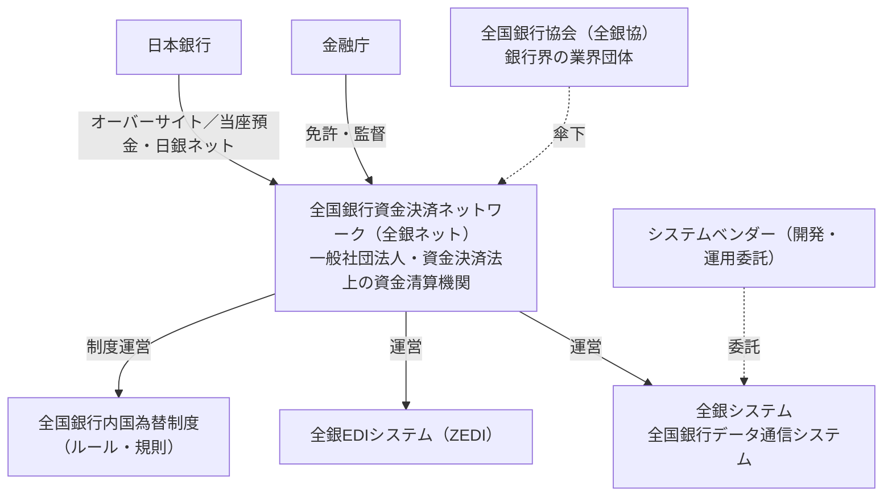

# 第1章　全銀システムの概要と運営主体

[目次](README.md)　｜　[次章 →](02_participation.md)

---

## 1.1 全銀システムとは

**全国銀行データ通信システム（全銀システム）** は、国内の金融機関どうしの **内国為替取引**（日本円による国内の振込など）を
オンラインで処理する決済システムです。利用者が「A銀行の自分の口座から B銀行の相手口座へ振り込む」とき、

1. A銀行から B銀行へ「この口座にいくら入金してください」という **為替通知** を届け、
2. A銀行と B銀行の間の **資金の受払（銀行間決済）** を計算・実行する

という2つの仕事を担います。

- 1973年4月に稼働。日本のほとんどの預金取扱金融機関が参加
- 2025年12月時点で **1営業日平均 約843万件・約17.5兆円**（年間 約20.4億件・約4,264兆円）
- 稼働当初から「受取人口座への即時入金」を実現していたことが特徴の一つ

## 1.2 運営主体の関係

ご質問にある「資金決済ネットワーク」は、正式には **一般社団法人 全国銀行資金決済ネットワーク（全銀ネット）** です。
関係は次のとおりで、**全銀ネットが全銀システムを運営する主体**、全銀ネットは **全国銀行協会（全銀協）の傘下** という位置づけです。

| 用語 | 何か |
|---|---|
| **全国銀行内国為替制度** | 加盟金融機関の間で為替取引を公正・円滑に行うためのルールの総体（制度） |
| **全銀システム** | その制度のもとで為替通知の送受信と決済額の計算を行うコンピュータシステム |
| **全銀ネット** | 制度とシステムを運営し、資金清算機関として銀行間決済の当事者（CCP）になる法人 |
| **全銀協** | 銀行界の業界団体。全銀ネットは全銀協の傘下にある |

運営体制の変遷（概要）:

| 時期 | 運営 |
|---|---|
| 1973年〜 | 全国銀行内国為替制度の発足と同時に全銀システム稼働 |
| 2001年1月 | 決済の相手方（セントラル・カウンターパーティ）を日本銀行から東京銀行協会に変更し、決済リスク対策を強化 |
| 2010年〜 | 全銀ネットが設立され、資金決済法上の **資金清算機関** として制度・システムの運営を承継 |

## 1.3 位置づけ — 日本の決済システムの中での役割

| システム | 運営 | 主な対象 | 決済方式 |
|---|---|---|---|
| 日銀ネット（当座預金系） | 日本銀行 | 金融機関間の大口資金、国債 | RTGS（即時グロス決済） |
| **全銀システム** | 全銀ネット | **内国為替（振込等）** | 1億円以上は日銀ネットで RTGS、1億円未満は時点ネット決済 |
| 外為円決済システム | 全銀協 | 外国為替取引の円資金 | RTGS 等 |
| 電子交換所 | 全銀協 | 手形・小切手（電子化された交換） | 交換尻の決済 |
| ことら | 株式会社ことら | 10万円以下の個人間送金 | 全銀システムの資金決済を利用 |

## 1.4 システムの特長（公開資料で強調されている点）

- **安全性・信頼性**: 1973年の稼働から2023年10月まで、顧客影響を伴う大規模な障害はなかった（2023年の障害は[仕組み編 第9章](../mechanism/09_incidents_and_bcp.md)）
- **即時性**: 振込は、被仕向銀行に為替通知が届いた時点で受取人口座に入金される（資金決済は後でまとめて行う）
- **24時間365日**: 2018年10月のモアタイムシステム稼働で、平日夜間・休日も即時振込が可能に
- **網羅性**: 銀行・信用金庫・信用組合・労働金庫・農漁協などほぼすべての預金取扱金融機関をカバー

## 1.5 この章のまとめ

- 全銀システム＝振込の「通知」と「銀行間決済額の計算」を担う、日本のリテール決済の中核
- 運営は全銀ネット（全銀協傘下の一般社団法人・資金清算機関）、監督は金融庁、日銀がオーバーサイト
- 振込は即時に入金、銀行間の資金は後から決済、という二段構え（→[仕組み編 第3章](../mechanism/03_immediate_credit_deferred_settlement.md)）

### 参考資料
- 全国銀行協会「全国銀行データ通信システム（全銀システム）」 https://www.zenginkyo.or.jp/abstract/efforts/system/zengin-system/
- 全国銀行協会「新内国為替制度への移行について」（2001年1月） https://www.zenginkyo.or.jp/news/2001/n2615/
- 金融庁 決済業務等の高度化に関するスタディ・グループ 資料「全銀システムの高度化に向けた取組み」（全銀ネット、2015年2月） https://www.fsa.go.jp/singi/singi_kinyu/kessai_sg/siryou/20150205/01_1.pdf
