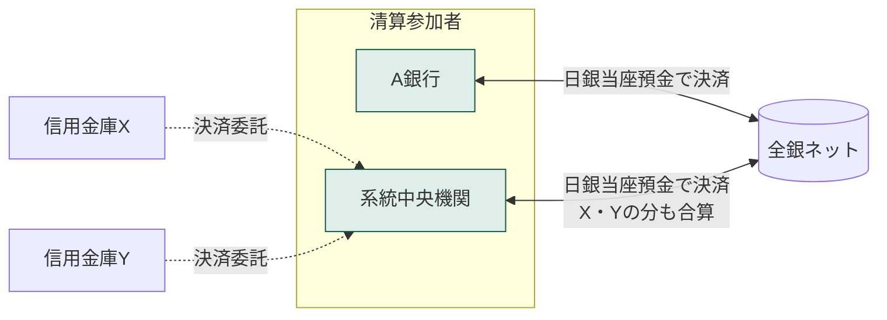

# 第2章　参加資格と参加形態

[← 前章](01_overview.md)　｜　[目次](README.md)　｜　[次章 →](03_services.md)

---

## 2.1 加盟銀行

全銀システムに参加する金融機関を **加盟銀行** と呼びます（「銀行」と呼ぶが、信用金庫・信用組合・労働金庫・農漁協等を含む）。

| 時点 | 加盟金融機関数 | 備考 |
|---|---|---|
| 2014年12月末 | 1,340 | うち清算参加者 143、代行決済委託金融機関 1,197 |
| 2023年（報道時点） | 約1,130、店舗約2.9万 | 合併・統合により減少傾向 |

2014年末時点の業態別内訳（全銀ネット資料）:

| 業態 | 加盟数 |
|---|---|
| 都市銀行 | 5 |
| 地方銀行 | 64 |
| 信託銀行 | 8 |
| 第二地方銀行協会加盟銀行 | 41 |
| 外国銀行 | 6 |
| 信金中金・信用金庫 | 268 |
| 全信組連・信用組合 | 153 |
| 労金連・労働金庫 | 14 |
| 農中・信連・信漁連・農協等 | 766 |
| その他（ゆうちょ銀行等） | 15 |

## 2.2 参加形態 — 清算参加者と代行決済委託金融機関

為替通知のやり取り（データ通信）と資金決済（お金の受払）は、参加形態によって扱いが異なります。

| 形態 | 為替通知 | 資金決済 | 典型例 |
|---|---|---|---|
| **清算参加者** | 全銀システムと直接接続 | 全銀ネットとの間で **自ら** 日本銀行当座預金を使って決済 | 大手・地方銀行、系統中央機関 |
| **代行決済委託金融機関** | 全銀システムと接続（自前または共同センター経由） | **清算参加者に委託**（代行決済）して決済 | 多くの信用金庫・信用組合・農協など |

- 代行決済委託金融機関の受払は、委託先の清算参加者のポジションに **合算** されてネッティングされます
- 仕向超過限度額や担保の管理も清算参加者単位で行われます（→[第7章](07_risk_management.md)）
- 模擬システムではこの合算を `ZenginCenter.sp()` で実装しています（[simulator](../simulator/README.md)）

## 2.3 参加資格の拡大（資金移動業者への開放）

長らく参加資格は **預金取扱金融機関** に限られていましたが、2022年に全銀ネットは参加資格を **資金移動業者** に拡大することを決定しました。
公表された要件（概要）は次のすべてを満たすことです。

1. 預金取扱金融機関または資金移動業者であること
2. 純資産額が負の値でないこと
3. 法令および業務方法書等にもとづき内国為替業務を適切に遂行できる経営体制・運用体制を整備していること

参加形態は「清算参加者（直接接続）」または「代行決済委託金融機関」から選択します。

背景:
- 公正取引委員会（2020年4月）が全銀システムの閉鎖性や銀行間手数料の高止まりを指摘
- 政府の成長戦略実行計画（2020年7月）で銀行間手数料の引下げ・資金移動業者のアクセス拡大が方針化
- 資金移動業者は、従来は銀行経由（銀行に口座を持ち、そこから振込）で全銀システムを間接利用していた

> 資金移動業者の種別（資金決済法）: 第一種（送金上限なし・認可制）、第二種（1回100万円以下）、第三種（1回5万円以下）

## 2.4 参加者の義務（概要）

全銀ネットの業務方法書・規則に基づき、参加者には概ね次のような義務があります（詳細は全銀ネットの規則）。

- システム接続のための設備（RC 等）・回線の整備と、全銀ネットが定める試験への参加
- 担保の差入れ（清算参加者）と、決済時刻までの決済資金の準備
- 障害時の連絡体制、BCP（業務継続計画）の整備
- 内国為替制度運営費・システム利用料の負担

### 参考資料
- 全銀ネット「全銀システムの高度化に向けた取組み」（2015年2月、金融庁SG資料） https://www.fsa.go.jp/singi/singi_kinyu/kessai_sg/siryou/20150205/01_1.pdf
- ビジネス＋IT「ついに開放される『全銀システム』、フィンテック企業への影響や課題とは?」（2022年9月） https://www.sbbit.jp/article/fj/95392
- 野村総合研究所「銀行間送金手数料は一律62円へ」（2021年3月） https://www.nri.com/jp/knowledge/blog/lst/2021/fis/kiuchi/0305
