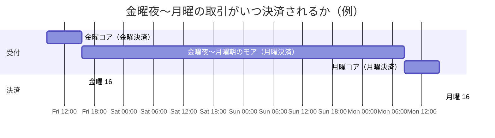

# 第4章　稼働時間とサービス区分

[← 前章](03_services.md)　｜　[目次](README.md)　｜　[次章 →](05_data_formats.md)

---

## 4.1 コアタイムとモアタイム

2018年10月のモアタイムシステム稼働により、全銀システムは **24時間365日** 為替取引を処理できるようになりました。
時間帯によって処理するシステムが分かれています。

| 区分 | 時間帯 | 処理するシステム | 取扱い |
|---|---|---|---|
| **コアタイム** | 平日（銀行営業日） 8:30〜15:30 | コアタイムシステム | 小口・大口とも当日扱い |
| **モアタイム** | 平日 15:30〜翌 8:30、土日祝・年末年始 終日 | モアタイムシステム | **1億円未満** の振込を即時処理（参加行どうし） |

```
         0:00      8:30                 15:30  16:15            24:00
平日     |== モア ==|====== コアタイム ======|== モアタイム ==========|
                                            ↑ 16:15 当日分の資金決済
土日祝   |================ モアタイム（終日）========================|
```

## 4.2 モアタイムへの参加は任意

- モアタイムへの参加は各金融機関の判断です。多くの金融機関が参加していますが、参加していない金融機関もあります
- 参加している場合も、モアタイムで受け付ける時間帯・金額上限・チャネル（ネットバンキングのみ等）は **金融機関ごとに異なります**
- 非参加の金融機関宛て、または非参加の金融機関からの振込は、夜間・休日に依頼しても **翌営業日の扱い** になります

## 4.3 取扱日と決済日

振込には「受取人に入金される日（取扱日）」と「銀行間で資金を決済する日（決済日）」があり、モアタイムではこれがずれます。

| 依頼のタイミング | 受取人への入金 | 銀行間の資金決済 |
|---|---|---|
| 平日 8:30〜15:30（コア） | 即時 | **当日** 16:15 |
| 平日 15:30〜24:00（モア） | 即時（双方参加時） | **翌営業日** 16:15 |
| 平日 0:00〜8:30（モア） | 即時（双方参加時） | **当日** 16:15 |
| 土日祝（モア） | 即時（双方参加時） | **翌営業日** 16:15 |
| 1億円以上・夜間休日 | 翌営業日のコアタイム | 翌営業日（RTGS） |

つまり、**前営業日 15:30 から当営業日 15:30 までに処理された小口取引** が、当営業日 16:15 にまとめて決済されます。
模擬システムでは `BusinessCalendar.settlement_date_for()` がこのルールを実装しています。



## 4.4 営業日の考え方

- 土曜・日曜・国民の祝日・振替休日・国民の休日は銀行休業日
- **12月31日〜1月3日** も銀行休業日（銀行法施行令）
- 休業日はコアタイムがなく、モアタイムのみ稼働

## 4.5 稼働時間拡大の経緯（概要）

| 時期 | 出来事 |
|---|---|
| 1973年 | 稼働開始（平日日中） |
| 2000年代〜 | 稼働時間の段階的な延長 |
| 2015年頃 | 全銀ネットが 24時間365日化の検討を表明（金融審議会 決済高度化SG） |
| 2018年10月 | **モアタイムシステム稼働**（平日夜間・休日の即時振込） |

### 参考資料
- 全銀ネット「全銀システムの高度化に向けた取組み」（2015年2月） https://www.fsa.go.jp/singi/singi_kinyu/kessai_sg/siryou/20150205/01_1.pdf
- 日本銀行「教えて！にちぎん」（2018年10月より24時間365日の即時送金環境） https://www.boj.or.jp/about/education/oshiete/kess/i27.htm
- Business Insider Japan（2023年10月、コアタイム・モアタイムの構成） https://www.businessinsider.jp/article/276648/
