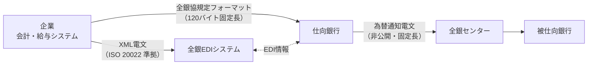

# 第5章　データ形式と文字コード

[← 前章](04_operating_hours.md)　｜　[目次](README.md)　｜　[次章 →](06_settlement.md)

---

全銀システムに関わるデータ形式は、大きく **2つの層** に分かれます。

| 層 | 区間 | 仕様の公開 | 代表例 |
|---|---|---|---|
| **顧客⇔銀行** | 企業・個人と取引銀行の間 | 公開（全銀協が規定） | 全銀協規定フォーマット（固定長）、全銀EDI（XML） |
| **銀行⇔全銀センター** | 各金融機関の RC と全銀センターの間 | **非公開** | 為替通知電文（固定長電文） |



## 5.1 全銀協規定フォーマット（総合振込）

企業が取引銀行に振込データを渡すための標準フォーマットで、会計ソフトや給与ソフトの多くが対応しています。

### 基本ルール

| 項目 | 仕様 |
|---|---|
| レコード長 | **120バイト固定長** |
| 文字コード | JIS（Shift_JIS 系）または EBCDIC（ヘッダーのコード区分で指定） |
| 改行 | 改行なし（連続）または各レコード末尾に CR/LF。銀行・サービスにより異なる |
| 数字項目（N） | 右詰め・前ゼロ |
| 文字項目（X） | 左詰め・後スペース。**半角カナ・英大文字・数字・一部記号** |

### レコード構成

```
ヘッダーレコード（データ区分=1） … 1件
データレコード  （データ区分=2） … 振込1件につき1レコード
トレーラーレコード（データ区分=8）… 合計件数・合計金額
エンドレコード  （データ区分=9） … 1件
```

| 種別コード（ヘッダー） | 用途 |
|---|---|
| 21 | 総合振込 |
| 11 | 給与振込 |
| 12 | 賞与振込 |

各レコードの項目配置（位置・桁数）は、模擬システムの解説に全項目を掲載しています →
[simulator/README.md「6.1 全銀協規定フォーマット」](../simulator/README.md#61-全銀協規定フォーマット総合振込-公開仕様に準拠)

主なチェック項目:
- トレーラーの合計件数・合計金額がデータレコードの実件数・実合計と一致するか
- 預金種目（1=普通、2=当座、4=貯蓄、9=その他）
- 受取人名に使用できない文字（漢字・小書きカナ等）がないか
- レコードの並び順（1 → 2… → 8 → 9）

### サンプル（データレコード1件・可視化）

```
2 9002 (銀行名15)   100 (支店名15)   0000 1 1000001 ﾔﾏﾀﾞ ﾀﾛｳ(30) 0000012345 0 (顧客ｺｰﾄﾞ等) 7 Y
^ ^    ^             ^   ^            ^    ^ ^       ^             ^          ^               ^ ^
| 被仕向銀行番号     支店番号          交換所 種目 口座番号 受取人名  振込金額  新規コード     | 識別表示(EDI)
データ区分                                                                         振込指定区分(7=テレ振込)
```

## 5.2 全銀で使える文字（半角カナ）

名義などの文字項目は、歴史的経緯から **半角カナ** が基本です。

| 種類 | 使える文字 |
|---|---|
| カナ | `ｱ`〜`ﾝ`、濁点 `ﾞ`、半濁点 `ﾟ`、`ｦ` |
| 英数字 | `A`〜`Z`（大文字のみ）、`0`〜`9` |
| 記号 | スペース、`(` `)` `-` `.` `/` `\` `,` `｢` `｣` |

主な変換ルール（慣行）:

| 入力 | 変換後 | 補足 |
|---|---|---|
| ャ ュ ョ ッ ァ 等の小書き | ﾔ ﾕ ﾖ ﾂ ｱ | 小書き文字は使えない |
| 長音「ー」 | `-` | |
| 英小文字 | 英大文字 | |
| 漢字・ひらがな | カナ読みに置換 | ひらがなはカナへ。漢字は読みを入力 |
| 株式会社 | 前置 `ｶ)`、後置 `(ｶ` | 例: ｶ)ｱｵﾊﾞｼﾖｳｼﾞ |
| 有限会社 / 合同会社 | `ﾕ)` / `ﾄﾞ)` | 他に医療法人 `ｲ)`、一般社団法人 `ｼﾔ)` 等 |

模擬システムの `kana.py` に変換ロジックを実装しています（`to_zengin_kana()`、`abbreviate_corporate()`）。

## 5.3 全銀EDIシステム（ZEDI）

- 2018年12月稼働。全銀ネットが運営
- 振込電文に **大量の商流情報（請求書番号・明細等）を添付** できるようにし、企業の **入金消込の自動化** を目的とする
- 企業と金融機関の間は **XML 電文（ISO 20022 準拠）**
- 従来の全銀協規定フォーマットの EDI 欄は **20桁** しかなく、請求書番号程度しか入らなかった課題を解消

| 比較 | 従来の EDI 情報 | 全銀EDI（ZEDI） |
|---|---|---|
| 容量 | 20桁（固定長フォーマット内） | 大容量（XML、明細を繰り返し可） |
| 形式 | 半角カナ・英数字 | XML（ISO 20022 準拠） |
| 主な用途 | 支払通知番号 | 請求書番号・明細・税額等 |

## 5.4 企業と銀行の間の通信手段

| 手段 | 概要 |
|---|---|
| 全銀協標準通信プロトコル（ベーシック手順） | 電話回線・ISDN 上の伝統的なファイル伝送手順。INS ネット（ディジタル通信モード）の提供終了（2024年1月）に伴い、IP 系への移行が進んだ |
| 全銀協標準通信プロトコル（TCP/IP 手順・広域 IP 網） | IP ネットワーク上のファイル伝送 |
| インターネットバンキング（法人向け） | ブラウザ・API 経由でファイルをアップロード |
| API（オープン API） | 銀行が提供する振込 API |

## 5.5 銀行⇔全銀センター間の電文（非公開）

- 各金融機関は **RC（中継コンピュータ）** を介して全銀センターと接続し、RC が勘定系の送金依頼を全銀システム所定の電文形式に変換します（→[仕組み編 第2章](../mechanism/02_relay_computer_and_network.md)）
- 電文仕様・コード体系は公開されていません
- 模擬システムでは、固定長・通番・MAC（メッセージ認証コード）という考え方を学ぶための **独自電文（178バイト＋MAC16バイト）** を定義しています → [simulator/README.md「6.2」](../simulator/README.md#62-模擬為替通知電文独自形式)

### 参考資料
- 全国銀行資金決済ネットワーク（全銀ネット）公式サイト https://www.zengin-net.jp/
- ITmedia「『全銀システム障害』とは何だったのか」（RC の役割） https://www.itmedia.co.jp/news/article/2312/28/1231228104/2
