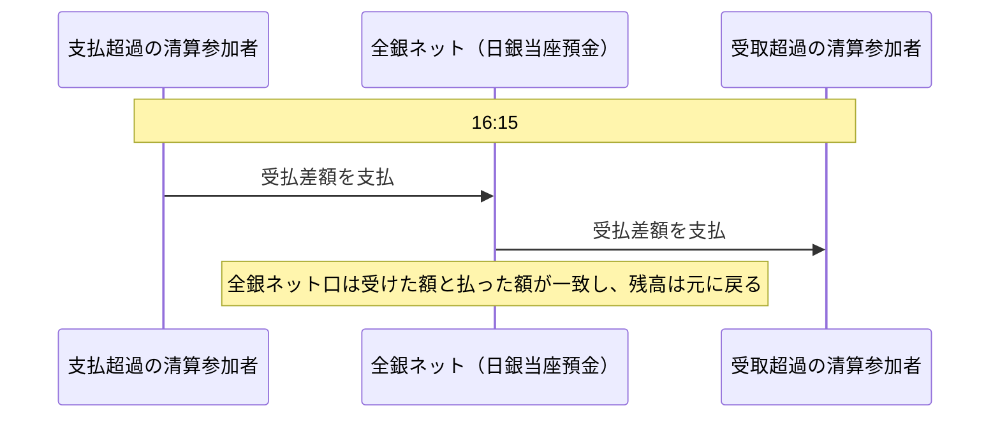

# 第6章　資金決済の仕様

[← 前章](05_data_formats.md)　｜　[目次](README.md)　｜　[次章 →](07_risk_management.md)

---

## 6.1 決済の基本

為替取引によって生じた金融機関間の資金の受払は、最終的に **日本銀行当座預金** 上で決済されます。
全銀ネットは **セントラル・カウンターパーティ（CCP）** として、すべての清算参加者の決済の相手方になります。

| 区分 | 基準 | 決済方式 | 決済タイミング |
|---|---|---|---|
| 大口内為取引 | 1件 1億円以上 | **RTGS**（即時グロス決済）— 日銀ネット | 取引ごと、即時 |
| 小口内為取引 | 1件 1億円未満 | **時点ネット決済**（多角的ネッティング後の受払差額）— 日銀ネット | 毎営業日 **16:15** |

## 6.2 大口内為取引（1億円以上）

- 支払指図ごとに、決済に必要な情報が全銀センターから **日銀ネット** に送信され、日本銀行当座預金上で **即時グロス決済** されます
- 仕向側の清算参加者の当座預金から、被仕向側の清算参加者の当座預金へ1件ずつ資金が移ります
- 決済が完了しないと（当座預金残高が不足すると）資金は動きません
- 2011年11月に、全銀システムの大口取引を日銀ネットの RTGS で決済する仕組みが導入されました（大口決済の決済リスク削減）

## 6.3 小口内為取引（1億円未満）

1. 全銀センターで、決済日ごとに個々の支払指図を集計する
2. 清算参加者ごとに **受払差額**（受取総額 − 支払総額）を計算する
3. 計算結果を日本銀行にオンラインで送信する
4. 当日 **16:15** に、各清算参加者と全銀ネットとの間で日本銀行当座預金の入金・引落しを行い、最終的に決済する

| 用語 | 意味 |
|---|---|
| 受払差額 | 清算参加者ごとの「受取額 − 支払額」。負なら支払、正なら受取 |
| 仕向超過額 | 支払額が受取額を上回る額（＝負の受払差額の絶対値）。リスク管理の対象（→[第7章](07_risk_management.md)） |
| 決済尻 | 受払差額の通称 |

## 6.4 決済対象期間

| 取引の処理時刻 | 決済日 |
|---|---|
| 前営業日 15:30 〜 当営業日 15:30 | 当営業日 16:15 |

モアタイムの取引は翌営業日（または当営業日朝までのものは当日）の 16:15 にまとめて決済されます（→[第4章](04_operating_hours.md)）。

## 6.5 決済の確実性（ファイナリティ）

- 小口取引では、受取人への入金（為替通知の着信時点）が資金決済（16:15）より **先に** 行われます
- そのため、16:15 に支払側の清算参加者が資金を払えない場合でも決済を完了させる仕組みが必要になります
- 全銀ネットは、仕向超過限度額の管理・担保・流動性供給銀行の組み合わせで **決済完了を確保** しています（→[第7章](07_risk_management.md)、[仕組み編 第7章](../mechanism/07_settlement_guarantee_and_default.md)）

## 6.6 模擬システムでの対応

| 仕様 | 実装 |
|---|---|
| 1億円の閾値 | `config.LARGE_VALUE_THRESHOLD` |
| RTGS | `ZenginCenter._execute_large()` → `BOJNet.transfer()` |
| ネッティング | `NettingEngine.record()` / `net_positions()` |
| 16:15 決済 | `SettlementService.settle()`（`Simulation.run_until()` が 16:15 を跨ぐと自動実行） |
| 全銀ネット口 | `config.ZENGIN_NET_ACCOUNT = "ZNET"` |

### 参考資料
- 日本銀行「教えて！にちぎん：民間資金決済システムでの金融機関間の受払」 https://www.boj.or.jp/about/education/oshiete/kess/i27.htm
- 全国銀行協会「全銀システム」 https://www.zenginkyo.or.jp/abstract/efforts/system/zengin-system/
- 全国銀行協会「大口決済システムの構築等資金決済システムの再編について（提言）」（2004年3月） https://www.zenginkyo.or.jp/news/2004/n2731/
