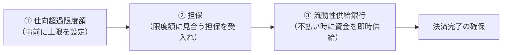
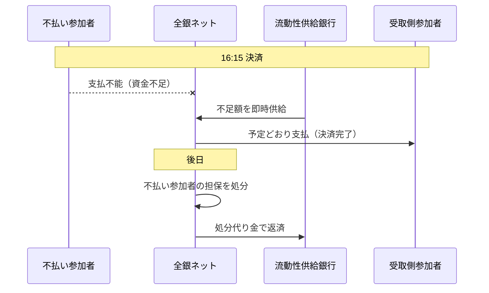

# 第7章　リスク管理の仕様

[← 前章](06_settlement.md)　｜　[目次](README.md)　｜　[次章 →](08_fees.md)

---

## 7.1 なぜリスク管理が必要か

小口取引では「受取人への入金」が先、「銀行間の資金決済」が後（16:15）です。もし支払側の銀行が 16:15 に資金を払えなければ、
受取側の銀行はすでに顧客に入金済みの資金を回収できず、連鎖的に他の銀行の決済にも影響が及びます（**システミック・リスク**）。

このため全銀ネットは、次の3つの仕組みを組み合わせています。



## 7.2 仕向超過限度額

| 項目 | 内容 |
|---|---|
| 仕向超過額 | 清算参加者の **支払額 − 受取額**（その決済日分） |
| 仕向超過限度額 | 清算参加者ごとに設定される仕向超過額の上限 |
| 管理方法 | 全銀システムが **リアルタイム** に仕向超過額を計算し、限度額を超える取引は処理されない |

- 新しい振込を受け付けると仕向超過額が限度額を超える場合、その振込は限度額内に収まるまで処理されません
- 他行から受け取る振込が増えれば仕向超過額は減るため、限度額に余裕が戻ります
- 代行決済委託金融機関の取引は、委託先清算参加者の仕向超過額に含まれます

模擬システムでの挙動（シナリオ `limit`）:
```
限度額 5,000万円 / 2,000万円×4件
  1件目 → 入金済（仕向超過 2,000万）
  2件目 → 入金済（仕向超過 4,000万）
  3件目 → 保留（4,000万＋2,000万 > 5,000万）
  4件目 → 保留（同一参加者の先行保留あり：順序維持）
  → 2,500万円を受け取る → 3件目が自動解除（仕向超過 3,500万）
  → 16:15 になっても4件目は限度額内に収まらず不受理・依頼人へ返金
```
> 保留中の取引の扱い（待ち時間・返却のタイミング等）の実際の運用ルールは全銀ネットの規則によります。上記は模擬上の設計です。

## 7.3 担保

- 清算参加者は、仕向超過限度額に見合う **担保**（国債等）を全銀ネットに差し入れます
- 担保は決済不能が生じた際に処分され、その代り金で損失を補填します
- 担保の種類・評価方法（掛け目）・必要額の算定方法は全銀ネットの規則で定められています

## 7.4 流動性供給銀行

- 清算参加者が 16:15 に決済資金を払えない場合、あらかじめ契約した **流動性供給銀行** が、不足資金を **即時に** 全銀ネットへ供給します
- これにより、他の清算参加者への支払は予定どおり行われ、決済は完了します
- 供給された資金は、後で不払い参加者の担保の処分代り金などで返済されます
- 担保処分で回収しきれない損失が出た場合の分担方法も規則で定められています（損失分担ルール）



## 7.5 その他のリスク管理

| リスク | 対策（公開資料ベース） |
|---|---|
| オペレーショナル・リスク | 東京・大阪の2センター、回線の多重化、障害時のバックアップ運用（→[第9章](09_system_architecture.md)） |
| 大口取引の決済リスク | 1億円以上は RTGS で取引ごとに決済し、未決済残高を積み上げない |
| 法的リスク | 資金決済法に基づく資金清算機関としての業務方法書、ネッティングの法的有効性の確保 |
| 不正送金・マネロン | 各金融機関側の取引モニタリング。新決済システム構想では事前口座確認の導入を検討（→[仕組み編 第10章](../mechanism/10_history_and_future.md)） |

## 7.6 国際基準との関係

全銀システムは日本銀行のオーバーサイトの対象であり、資金決済システムに関する国際基準「金融市場インフラのための原則（PFMI、2012年 CPSS-IOSCO）」
に照らした評価・情報開示が行われています。PFMI は、ネット決済システムに対し「最大の参加者が決済不能になっても決済を完了できる」流動性の確保などを求めています。

### 参考資料
- 全国銀行協会「全銀システム」（仕向超過額の限度額管理と担保） https://www.zenginkyo.or.jp/abstract/efforts/system/zengin-system/
- 全国銀行協会「新内国為替制度への移行について」（2001年、決済リスク対策の強化） https://www.zenginkyo.or.jp/news/2001/n2615/
