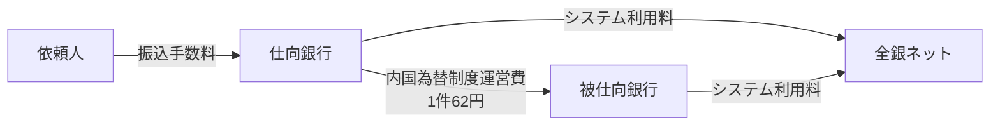

# 第8章　手数料・費用

[← 前章](07_risk_management.md)　｜　[目次](README.md)　｜　[次章 →](09_system_architecture.md)

---

## 8.1 費用の全体像

振込にかかわる費用は、誰と誰の間のものかで区別すると分かりやすくなります。

| 費用 | 誰が誰に払うか | 内容 |
|---|---|---|
| **振込手数料** | 依頼人（顧客） → 仕向銀行 | 各金融機関が自由に設定。窓口・ATM・ネットで異なる |
| **内国為替制度運営費** | 仕向銀行 → 被仕向銀行 | 被仕向側の入金処理等のコストを、制度として仕向側が負担 |
| **全銀システム利用料等** | 加盟銀行 → 全銀ネット | システムの維持運営費。取引量等に応じて負担 |

## 8.2 内国為替制度運営費（2021年10月〜）

| 項目 | 内容 |
|---|---|
| 導入 | 2021年10月（それまでの「銀行間手数料」を廃止して創設） |
| 金額 | **1件あたり 62円**（金額の多寡によらず一律） |
| 負担 | 仕向銀行が被仕向銀行に支払う |
| 位置づけ | 全銀ネットが制度の運営に必要なコストとして定めるもの。各行が相対で決めるものではない |

### 旧「銀行間手数料」との比較

| | 旧 銀行間手数料（〜2021年9月） | 内国為替制度運営費（2021年10月〜） |
|---|---|---|
| 金額 | 3万円未満 117円 / 3万円以上 162円（一般的な水準） | 一律 62円 |
| 決め方 | 各金融機関の間で相対で決定（実態は横並び） | 全銀ネットが制度として決定 |
| 見直し | 1970年代以降、ほぼ据え置き | コストに基づき定期的に検証 |

### 見直しの背景

- 2020年4月、公正取引委員会が報告書で、銀行間手数料が長年にわたり高止まりしていることや全銀システムの閉鎖性を指摘
- 2020年7月、政府の「成長戦略実行計画」で銀行間手数料の引下げが方針化
- これを受けて、多くの金融機関が 2021年秋に **他行宛振込手数料を引き下げ** ました

## 8.3 システム運営コスト

- 全銀システムの開発・運用費用は、加盟銀行が取引量等に応じて負担しています
- 2021年度のシステムコストは為替取引1件あたり約9.2円と試算されたとの報道があります
- 現行システムの維持コストが高止まりしていることは、新決済システム構想の背景の一つとされています（→[仕組み編 第10章](../mechanism/10_history_and_future.md)）

## 8.4 模擬システムでの扱い

`fees.py` の `FeeLedger` が、振込（1001/1002 電文）1件ごとに仕向銀行 → 被仕向銀行の 62円を月次で集計します。
シナリオ `normal` の最後に当月集計が表示されます。返却・組戻電文は集計対象外としています（模擬上の簡略化）。

### 参考資料
- 野村総合研究所「銀行間送金手数料は一律62円へ」（2021年） https://www.nri.com/jp/knowledge/blog/lst/2021/fis/kiuchi/0305
- Business Insider Japan「全銀システムへの資金移動業者の参加」（2022年8月、システムコスト1件約9.2円、運営費62円） https://www.businessinsider.jp/article/258193/
