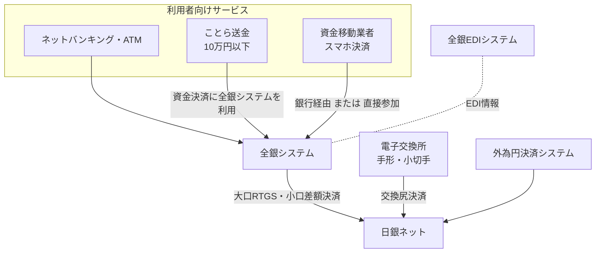

# 第10章　法的枠組みと関連システム

[← 前章](09_system_architecture.md)　｜　[目次](README.md)　｜　[仕組み編へ →](../mechanism/README.md)

---

## 10.1 法的枠組み

| 法令・枠組み | 全銀システムとの関係 |
|---|---|
| **資金決済に関する法律（資金決済法）** | 全銀ネットは同法に基づく **資金清算機関** として免許を受け、金融庁の監督を受ける。業務方法書の策定、報告義務などが定められる |
| 金融庁の監督 | 報告徴求・業務改善命令等。2023年10月の障害では、資金決済法第80条第1項に基づく報告徴求命令が出された |
| 日本銀行のオーバーサイト | 決済システムの安全性・効率性を中央銀行の立場からモニタリング |
| PFMI（金融市場インフラのための原則） | 国際基準。リスク管理・ガバナンス・情報開示の水準 |
| 銀行法等 | 為替取引は銀行業の固有業務。資金移動業者は資金決済法に基づき為替取引を行う |
| 全国銀行内国為替制度の規則 | 業務方法書・規則・取扱要領等。参加者間の権利義務を定める |

## 10.2 関連する決済システム

### 日銀ネット

- 日本銀行が運営する金融ネットワークシステム（1988年稼働、2015年に新日銀ネットへ全面移行）
- 全銀システムの資金決済（大口 RTGS・小口差額決済）は、すべて日本銀行当座預金上で行われる

### 全銀EDIシステム（ZEDI）

- 2018年12月稼働。振込に大容量の EDI 情報を添付できる（→[第5章](05_data_formats.md)）

### 電子交換所

- 2022年11月、全国の手形交換所に代わって稼働した、手形・小切手の電子データを交換する仕組み（全銀協運営）
- 政府・産業界は手形・小切手の利用廃止を目指しており、振込・電子記録債権への移行が進む

### ことら

- 大手銀行等が出資する株式会社ことらが運営する、**10万円以下の個人間送金** のためのサービス（2022年10月開始）
- 携帯電話番号等で送金でき、低コスト。資金決済には全銀システムを利用（ことら経由の取引を一括して決済）

### 資金移動業者のサービス

- スマホ決済事業者などは、銀行口座からのチャージ・出金で全銀システムを利用（従来は銀行経由）
- 2022年の参加資格拡大で、資金移動業者も全銀システムへ直接参加が可能になった（→[第2章](02_participation.md)）

## 10.3 国際比較（参考）

| 国・地域 | 小口即時決済システム | 備考 |
|---|---|---|
| 日本 | 全銀システム（1973〜） | 即時入金は早期から実現。資金決済は時点ネット |
| 英国 | Faster Payments（2008〜） | 24時間即時 |
| ユーロ圏 | TIPS（2018〜）、SCT Inst | 中央銀行マネーで即時決済 |
| 米国 | RTP（2017〜）、FedNow（2023〜） | |
| インド | UPI（2016〜） | 携帯番号・ID ベース、爆発的普及 |
| タイ / シンガポール | PromptPay / PayNow | QR・携帯番号、相互接続 |

各国では QR コードや携帯番号による送金、ISO 20022 電文、国際間の相互接続が進んでおり、全銀ネットの新決済システム構想の背景となっています
（→[仕組み編 第10章](../mechanism/10_history_and_future.md)）。

### 参考資料
- paymentnavi「全銀ネットがシステム障害での再発防止策を説明」（2023年12月、資金決済法第80条第1項の報告徴求命令） https://paymentnavi.com/paymentnews/139685.html
- 日本銀行「決済システムの高度化と日本銀行」（2016年3月） https://www.boj.or.jp/about/press/koen_2016/ko160318a.htm
- 国際通貨研究所「日本のキャッシュレス化の現状と全銀システム刷新の含意」（2026年3月） https://www.iima.or.jp/docs/column/2026/ei2026.9.pdf
